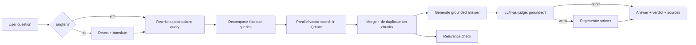

<div align="center">

# 📓 NotebookLLM

**Chat with your documents — with answers that verify themselves.**

A NotebookLM-style RAG app where you upload a PDF, TXT, or CSV and have a real conversation with it. Every answer is grounded strictly in your document and graded by an LLM-as-judge before you ever see it.

[](https://react.dev)
[](https://nodejs.org)
[](https://expressjs.com)
[](https://groq.com)
[](https://qdrant.tech)
[](https://vitejs.dev)

[**Live Demo →**](https://notebook-llm-sigma.vercel.app)

</div>

---

## ✨ Why it's different

This isn't a basic "embed → search → answer" RAG. It's an **advanced pipeline** that cleans up the question, searches smarter, and checks its own work:

| Feature | What it does |
|---|---|
| 🌍 **Multilingual** | Ask in any language — the question is translated to English for retrieval and the answer is translated back. |
| ✍️ **Query rewriting** | Turns a follow-up like *"and what about its cost?"* into a standalone search query using chat history. |
| 🧩 **Sub-query decomposition** | Splits a complex question into focused sub-questions, retrieves for each, then merges and de-duplicates. |
| ⚖️ **LLM-as-judge** | Scores every answer for *groundedness* and *relevance*; weak answers are auto-regenerated, and the verdict is shown in the UI. |
| 🔒 **Strictly grounded** | The model answers only from retrieved context and cites source numbers — no outside knowledge. |
| 🔍 **Full transparency** | Expand any answer to inspect the rewritten query, sub-queries, judge verdict, and the exact chunks used. |

---

## 🧠 How a question flows



**On upload:** the file is loaded, chunked, embedded locally with Transformers.js, and stored as vectors in Qdrant.

---

## 🛠️ Tech Stack

| Layer | Technology |
|---|---|
| **Frontend** | Vite + React + Tailwind CSS |
| **Backend** | Node.js + Express |
| **Answer LLM** | Groq `openai/gpt-oss-120b` |
| **Judge LLM** | Google `gemini-2.0-flash` *(falls back to Groq if no Gemini key)* |
| **Embeddings** | Local `Xenova/bge-small-en-v1.5` (384-dim) |
| **Vector DB** | Qdrant Cloud |

---

## 🚀 Quick Start

> **Prerequisites:** Node.js 18+, free API keys from [Groq](https://console.groq.com) and a [Qdrant Cloud](https://cloud.qdrant.io) cluster. A [Google AI Studio](https://aistudio.google.com/apikey) key is optional (enables the Gemini judge; otherwise it falls back to Groq). The embedding model runs locally and does not require Hugging Face credits.

### 1. Backend

```bash
cd backend
npm install --legacy-peer-deps
cp .env.example .env      # fill in your keys
npm run dev               # → http://localhost:3000
```

`backend/.env`:

```env
QDRANT_URL=https://<your-cluster>.cloud.qdrant.io:6333   # ⚠️ include the :6333 port
QDRANT_API_KEY=<your-qdrant-key>
QDRANT_COLLECTION_NAME=<collection-name>
GROQ_API_KEY=<your-groq-key>
GEMINI_API_KEY=<your-gemini-key>     # optional
PORT=3000
```

### 2. Frontend

```bash
cd frontend
npm install
npm run dev               # → http://localhost:5173
```

`frontend/.env`:

```env
VITE_API_URL=http://localhost:3000   # point at local backend; omit to use the deployed API
```

Open the app, upload a document, and start asking. 🎉

---

## 📡 API Reference

| Method | Endpoint | Description |
|---|---|---|
| `POST` | `/api/upload` | Upload & ingest a document (`multipart/form-data`, field `document`) |
| `DELETE` | `/api/upload` | Remove the indexed document |
| `POST` | `/api/chat` | Ask a question — body `{ query, history }` |
| `GET` | `/api/status` | Index readiness and vector count |
| `GET` | `/api/health` | Health check |

---

## 🧱 Chunking Strategy

**PDF / TXT — RecursiveCharacterTextSplitter** · size `1000`, overlap `200`
Splits on natural boundaries in priority order (paragraph → line → sentence → word → character), so chunks never break mid-word and the overlap preserves context across boundaries.

**CSV — Row-batch chunking** · 10 rows per chunk
Each row becomes `Column: value | Column: value`, with column names repeated in every chunk so the model always knows what each value means.

---

## 📂 Project Structure

```
NotebookLLM/
├── backend/
│   └── src/
│       ├── config/      → gemini.js · groq.js · qdrant.js
│       ├── routes/      → upload.js · chat.js · status.js
│       ├── services/    → ingestionService · chatService · translator
│       │                  queryRewriting · subQueries · llmJudge
│       ├── middleware/  → errorHandler.js
│       └── index.js
└── frontend/
    └── src/
        ├── components/  → UploadZone.jsx · ChatMessage.jsx
        ├── lib/         → api.js
        └── App.jsx
```

---

<div align="center">

Built with ❤️ as a NotebookLM-style clone · Groq · Qdrant · LLM-as-judge

</div>
